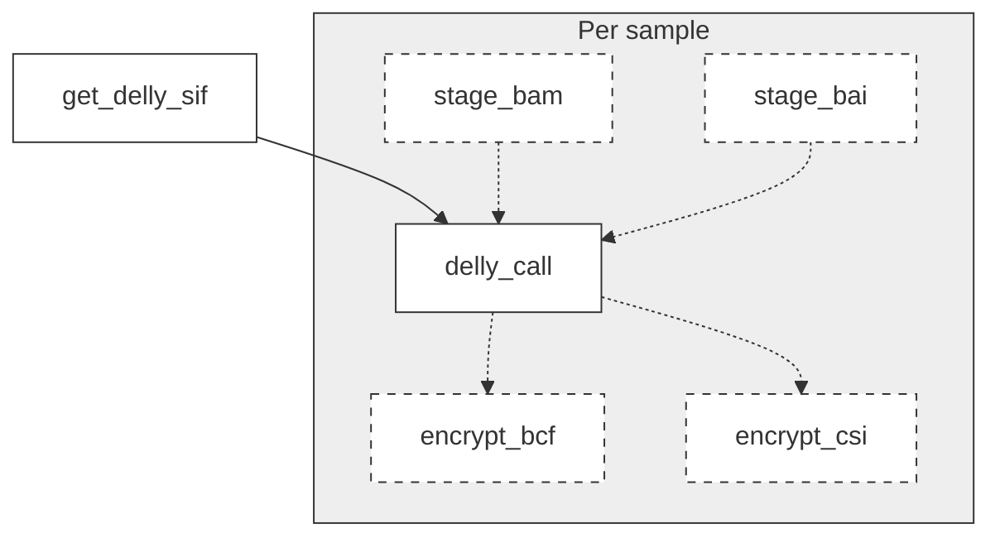
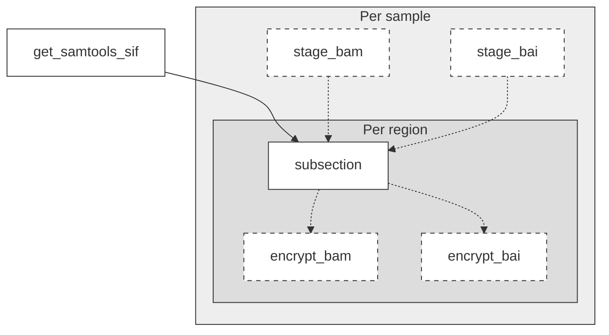

# ega2germlinedelly

Small [GWF](https://github.com/gwforg/gwf) workflows for working with BAMs, which can optionally be downloaded from EGA with [pyega3](https://github.com/EGA-archive/ega-download-client) (given EGAF IDs and a valid [EGA credential file](https://github.com/EGA-archive/ega-download-client/blob/master/pyega3/config/default_credential_file.json)), and whose outputs can optionally be encrypted with gpg.

| Workflow | Entrypoint | Config / input | What it does |
| --- | --- | --- | --- |
| Delly | `workflow.py` (default) | `config.json` / `input.csv` | Germline SV calling with Delly 0.8.7 |
| Subsection | `subsection.py` | `subsection_config.json` / `subsection_input.csv` | Extracts `chrom:start-end` regions into new BAMs with samtools |

## Requirements
- python3 3.10.12
- [gwf](https://github.com/gwforg/gwf) 2.1.1
- [singularity](https://sylabs.io/singularity) 3.11.0 (Delly and samtools run from containers fetched by the workflows)
- [pyega3](https://github.com/EGA-archive/ega-download-client) 5.1.0 (optional)

## Installation
```
git clone git@github.com:tomdrever/ega2germlinedelly.git
python3 -m venv .venv
. .venv/bin/activate
pip install -r requirements.txt
```

## Configuration
Both workflows read a JSON config. Unknown or missing keys are reported as errors.

Shared keys:

| Key | Required | Description |
| --- | --- | --- |
| `staging_dir` | yes | Where EGA downloads are staged (one subdirectory per sample) |
| `out_dir` | yes | Where outputs and containers are written |
| `pre_script` | no | Shell run at the start of every job, e.g. `module load singularity` |
| `post_script` | no | Shell run at the end of every job |
| `singularity_flags` | no | Extra flags for `singularity exec`, e.g. `--bind /scratch:/scratch` |
| `ega_credentials_path` | if using EGA IDs | pyega3 credentials file |
| `gpg_key_path` | no | If set, every output is also encrypted (symmetric AES256) with the passphrase in this file |

Delly only: `ref_path` (reference FASTA), `sites_path` (Delly sites BCF).
Subsection only: `samtools_image` (defaults to `docker://quay.io/biocontainers/samtools:1.23.1--ha83d96e_0`).

Both input CSVs start with the same columns describing where each sample's BAM comes from: `sample_id`, then **either** `ega_bam_file_id` and `ega_bai_file_id` **or** `file_path` (a local BAM with its index at `<file_path>.bai`). Blank lines and lines starting with `#` are ignored.

## Delly workflow


Input (`input.csv`), one row per sample:
```
#sample_id,ega_bam_file_id,ega_bai_file_id,file_path
```

Outputs: `<out_dir>/<sample_id>/<sample_id>.bcf` and `.bcf.csi`.

1. Copy and fill out the template config file and input csv.
    ```
    cp config.json.template config.json
    cp input.csv.template input.csv
    ```

2. Check the targets generated.
    ```
    gwf status
    ```

3. Run the workflow.
    ```
    gwf run
    ```

4. (Optional) Remove the intermediates, see [Cleaning up](#cleaning-up).
    ```
    gwf clean
    ```

## Subsection workflow


Input (`subsection_input.csv`), one row per region. A sample can have several rows, and is only downloaded once. `start` and `end` are 1-based and inclusive, as in samtools.
```
#sample_id,ega_bam_file_id,ega_bai_file_id,file_path,chrom,start,end
SAMPLE1,EGAF...,EGAF...,,chr8,127700000,127800000
SAMPLE1,EGAF...,EGAF...,,chr17,7660000,7690000
```

Outputs: `<out_dir>/<sample_id>/<sample_id>.<chrom>_<start>_<end>.bam` and `.bam.bai`. The output contains every read that overlaps the region (as `samtools view` does), so reads may extend past either end, and mates mapped outside the region are not included.

The commands are the same as for Delly, with `-f subsection.py`:
```
cp subsection_config.json.template subsection_config.json
cp subsection_input.csv.template subsection_input.csv
gwf -f subsection.py status
gwf -f subsection.py run
gwf -f subsection.py clean
```

## Cleaning up
`gwf clean` deletes the outputs of every target that has a later step, and keeps the final outputs:
- Staged EGA BAMs/BAIs are always removed.
- If encrypting, the unencrypted outputs (Delly BCFs, subsection BAMs) are removed and the `.gpg` files kept.
- The Delly and samtools containers are protected, so they are kept for later runs.

Both workflows can be run from the same directory and share gwf's `.gwf` state. A sample in both inputs with the same `staging_dir` is downloaded once and shared, but cleaning one workflow will delete the staged BAM, so the other will download it again if it still needs it.

## Code layout
```
workflow.py / subsection.py   entrypoints
models.py                     config classes and input row types
common/config.py              config loading
common/samplesheet.py         input CSV parsing and validation
common/targets.py             shared steps: container fetch, EGA staging, encryption
templates/                    gwf target templates (pyega3/gpg, delly, samtools)
```
